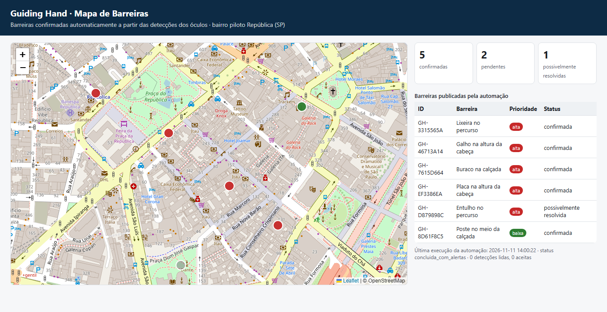

# Guiding Hand · Automação de Barreiras (RPA)

> FIAP · Global Solution 11.2026 · CitizenTech · Engenharia de Software 4º ano
> Disciplina: Robotic Process Automation (Prof. Bruno Diniz)

O **Guiding Hand** é um par de óculos inteligentes que ajuda pessoas cegas ou com baixa visão a andar pela cidade.
Cada obstáculo detectado pelos óculos vira um registro anônimo. **Esta automação transforma milhares desses registros
em um mapa de barreiras confiável e em um relatório para a zeladoria**, sem ninguém precisar conferir planilhas à mão.

## Integrantes

| Nome completo | RM |
|---|---|
| João Rodrigo Solano Nogueira | RM551319 |
| Julia Amorim Bezerra | RM99609 |
| Lana Giulia Auada Leite | RM551143 |
| Tony Willian da Silva Segalin | RM550667 |

**Repositório:** https://github.com/LanaAuada/guiding-hand-rpa

## O problema e o que a automação faz

**Sem a automação**, alguém da equipe teria de juntar todo dia os arquivos de detecção, descartar pessoas e
carros, conferir se o mesmo buraco foi visto por vários usuários, atualizar o mapa e montar a planilha da
zeladoria à mão. O processo seria lento e cheio de erros, e um único falso alarme poderia desviar a rota de alguém.

**Com a automação**, o robô roda sozinho todo dia e:

1. coleta detecções da **API da nuvem dos óculos** e de **arquivos JSON/CSV**;
2. **valida** cada detecção e descarta duplicadas, obstáculos móveis e baixa confiança;
3. **agrupa** detecções próximas (célula de ~30 m) e **confirma** a barreira só quando 3 ou mais óculos diferentes a viram;
4. marca como **possivelmente resolvida** a barreira que não aparece há 30 dias;
5. publica o **mapa GeoJSON** (consumido pelo app/MVP) e o **relatório CSV** da zeladoria;
6. grava **log detalhado** e **trilha de auditoria**, sem dados pessoais.

## Arquitetura

```
 Óculos ──► Nuvem Guiding Hand ──► API /deteccoes ─┐
                                  arquivos JSON/CSV ┤
                                                    ▼
                         ┌────────── Robô RPA (Python) ───────────┐
                         │ leitura.py → regras.py → saida.py      │
                         │        (orquestrado por main.py)       │
                         └──────┬───────────────┬────────────┬────┘
                                ▼               ▼            ▼
              saida/mapa_barreiras.geojson  relatorio CSV   logs/
                     │                     (zeladoria)   (auditoria)
                     ▼
            mvp/index.html (mapa do app)
```

| Arquivo | Responsabilidade |
|---|---|
| [src/main.py](src/main.py) | Orquestra o fluxo, trata exceções, gera log e resumo |
| [src/leitura.py](src/leitura.py) | Lê arquivos JSON/CSV e a API (com novas tentativas) |
| [src/regras.py](src/regras.py) | Regras de negócio R1 a R8 (validação, decisão, prioridade, LGPD) |
| [src/saida.py](src/saida.py) | Estado, GeoJSON, CSV, resumo e auditoria (gravação atômica) |
| [src/config.py](src/config.py) | Parâmetros das regras e pastas |
| [src/gerar_dados_exemplo.py](src/gerar_dados_exemplo.py) | Gera dados simulados dos óculos para a demonstração |
| [src/api_simulada.py](src/api_simulada.py) | API local que simula a nuvem dos óculos |
| [mvp/index.html](mvp/index.html) | Tela do MVP que consome o mapa gerado |

## Como executar

Requisito: **Python 3.10+**. Não precisa instalar nenhuma biblioteca, porque o projeto usa só a biblioteca padrão.

```bash
# 1. Gerar dados de exemplo (limpa data/ e saida/)
python -m src.gerar_dados_exemplo

# 2. Rodar a automação com os arquivos locais
python -m src.main

# 3. (opcional) Rodar com a API: em outro terminal, suba a API simulada
python -m src.api_simulada
python -m src.main --api http://localhost:8001/deteccoes

# 4. Simular API fora do ar (o robô tenta 3 vezes e segue com os arquivos)
python -m src.main --api http://localhost:9999/deteccoes

# 5. Ver o resultado no MVP
python -m http.server 8000
# abra http://localhost:8000/mvp/

# 6. Rodar os testes
python -m unittest -v
```

Em produção, o robô é agendado no Agendador de Tarefas do Windows ou no `cron` para rodar todo dia às 06h,
com `GH_SALT` definido como variável de ambiente.

## Regras de negócio

| Regra | Descrição | Tipo |
|---|---|---|
| R1 | Campos obrigatórios, coordenada dentro de São Paulo, confiança entre 0 e 1, data ISO, tipo conhecido | Decisão |
| R2 | Mesmo `id_deteccao` só conta uma vez, inclusive entre execuções | Decisão |
| R3 | Pessoa, ciclista, animal e carro são móveis e não viram barreira | Decisão |
| R4 | Confiança abaixo de 0,5 é descartada como ruído | Decisão |
| R5 | Posição generalizada para uma célula de ~30 m, e o ID dos óculos vira hash (LGPD) | Processamento |
| R6 | **Confirmada** com 3 ou mais óculos diferentes, senão **pendente** | Decisão |
| R7 | Prioridade pelo tipo de risco; 10 ou mais detecções elevam para **alta** | Decisão |
| R8 | Confirmada sem detecção há mais de 30 dias vira **possivelmente resolvida** | Decisão |

As **repetições** acontecem em três níveis: sobre cada fonte (API e arquivos), sobre cada detecção e sobre cada barreira.

## Exceções e resiliência

| Situação | O que o robô faz |
|---|---|
| API fora do ar | 3 tentativas com espera crescente (1s, 2s); depois registra ERRO e segue com os arquivos |
| Arquivo corrompido, vazio ou com extensão errada | Registra ERRO e move o arquivo para `data/rejeitados/` (quarentena); os demais seguem |
| Registro inválido | Rejeita com o motivo no log e continua o lote |
| Detecção duplicada | Ignora (guarda os IDs já processados) |
| Pasta de entrada ausente | Cria a pasta e registra AVISO |
| Estado corrompido | Guarda uma cópia `barreiras_corrompido_*.json` e recomeça |
| Erro inesperado num registro | Registra com stack trace; o lote continua |
| Falha durante a gravação | Gravação atômica; os arquivos só saem da entrada depois de salvar, então são reprocessados |
| Falha crítica | Status `falha`, log CRITICAL, auditoria registrada e código de saída 1 (nunca falha em silêncio) |

## Logs e auditoria

- `logs/execucao_<id>.log`: data/hora, nível, cada decisão e cada erro
- `logs/auditoria.jsonl`: uma linha por execução, com totais, status e alertas
- `saida/resumo_execucao.json`: resumo da última execução (lido pelo painel do MVP)

Os logs **nunca** contêm o ID dos óculos nem imagens, só o ID da detecção, o tipo e os totais.

## Integração com o MVP

A automação publica `saida/mapa_barreiras.geojson` (padrão GeoJSON, aceito por Leaflet, Google Maps e
Mapbox). O app do Guiding Hand usa esse arquivo para **mostrar as barreiras** e **evitar essas ruas no
cálculo de rotas**. A tela [mvp/index.html](mvp/index.html) lê o arquivo e o resumo e exibe o mapa:



## Estrutura do repositório

```
src/        código-fonte Python
tests/      testes automatizados e evidências
docs/       fluxo BPMN, imagem do fluxo e relatório técnico (PDF)
assets/     prints e saídas de terminal
logs/       amostras de logs gerados (sem dados sensíveis)
mvp/        tela do MVP que consome o resultado
data/       entrada, processados, rejeitados e estado (dados simulados)
saida/      mapa GeoJSON, relatório CSV e resumo
```

## Segurança e LGPD

- O ID dos óculos é anonimizado com SHA-256 e um *salt* secreto (`GH_SALT`), que nunca é gravado.
- A localização é generalizada para ~30 m, e as saídas públicas trazem só contagens.
- Imagens não passam pela automação; os óculos já enviam apenas o tipo e a posição.
- Os dados deste repositório são **simulados**.
- Não há senhas no código; a configuração sensível vem de variáveis de ambiente.
